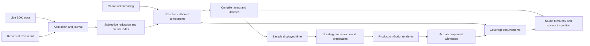

# Godot client review and shared Studio design — 13 October 2026

The current first delivery is specified in the [base-mechanics Studio plan](GODOT_STUDIO_BASE_MECHANICS_PLAN_2026-10-13.md). It incorporates the later user requests for a half-screen resizable preview/timeline, recovered TS/Pygame layers, immediate native base-action VFX, blood/material flashes, condition coverage and sound. Its implementation slices supersede the older ordering below for that first chunk; the findings here remain review evidence, not completion claims.

Review baseline: `0635d5f`. This is a review and implementation design, not a
claim that Studio or all animation families have been implemented. The concurrent
Alt highlight repair is a separate small correction identified by the user.
That repair is implemented: source preparation is input-neutral, and the workshop
reapplies its explicitly owned highlight after rebuilding camera sources. Its
48 headless material-state checks pass; this is not a native pixel comparison.

The useful foundation already exists: current SDK admission and reduction,
recorded replay, causal groups, a displayed clock, authoring lookup, staged media
and world preparation, and the production Godot renderer. The central gap is that
compilation and coverage still describe only a subset of the authored visuals.
Adding a separate Studio scheduler would preserve that gap instead of fixing it.

## Findings

| Priority | Finding and trigger | Evidence and consequence |
|---|---|---|
| P1 | The event inspector can certify incomplete animation. A dashing movement samples its body but omits its authored effects. | `presentation/event_trace.gd:64` requires a step body only. The real movement context selects `dash.back` and `dash.front`, yet a body-only witness produces public `presented`. Unknown families also default to `state_only_no_animation_claim` at line 142. Missing support can therefore appear green or neutral. |
| P1 | Destroyed world objects can retain intact artwork. | Replaying the user's actual Gallery prefix retains two destroyed portal walls, a torch and a table. `presentation/world.gd:29` projects integrity only for doors. The door fix is sound but not a general destruction implementation. The same prefix's five `object_destroyed` events have no required visual components. |
| P1 | Authored attached effects are deliberately excluded from live characters. | `presentation/characters.gd:57` removes clip-layer slots; lines 61 and 83 also exclude effect slots. The inspected rigs contain 19 enabled clip layers. Missing creature attack accents and modular effects cannot be solved by a timeline UI alone. |
| P2 | Every registered engaged trap selects an invalid authored state. | `presentation/world.gd:48` emits `active`; all 12 trap owners expose `activated`. `source_catalog.gd:266` indexes the selected key directly. The value probe reproduces 12 unresolved selections. |
| P2 | Executable and diagnostic recipe resolution diverge. | `presentation/authoring.gd:27` resolves attack variants for actor/anchors; `event_trace.gd:73` separately applies projectile/VFX/feedback/trail overrides. A third resolution inside Studio would add another source of disagreement. |
| P2 | Stabilizing a fallen actor replays its falling animation. | `presentation/compiler.gd:152` schedules the life application clip from zero. The authored modular dying and stable rests both hold `Die` at 1.25 seconds, yet dying→stable produces another 1,250 ms track from frame 0. A headless compiler value probe reproduces this; unchanged resting poses need to remain held. |
| P2 | Current playback has no general retained effect lifetime or backward seek. | `presentation/timeline.gd:380` samples current-group actor tracks; group completion retires that group. `session.gd:261` opens recordings, but this is forward replay rather than arbitrary-time transport. Persistent conditions, projectiles, deposits and removal transitions need ownership beyond a group's lifetime. |
| P2 | Alt leaks into cached source materials. | `presentation/sprite_sources.gd:213` samples physical Alt during construction; live Play has no matching release update. A wall built while Alt is held remains green. Source construction must be input-independent; workshop highlighting already has its own input path. |

These are confirmed source/value-boundary findings. The review did not repeat a
complete live performance campaign or claim every client path is defect-free.
The approved lighting, artwork and existing live preview remain outside the
Studio redesign; no new normals were imported.

Reproducible evidence is in
[`generated/client_studio_review_evidence.json`](../generated/client_studio_review_evidence.json).
Run `tools/audit_presentation_coverage.gd -- --recording <current-SDK-journal>`
with native Godot headless. It compiles the real recorded prefix, inspects settled
diagnostics without renderer witnesses, projects its retained destroyed objects,
checks engaged trap source selection and inspects the installed Godot API. It
does not create gameplay outcomes. Supplementary headless value probes and their
logs are retained in ignored `.runtime/studio-audit/`; the compact results are in
`generated/studio_diagnostic_probes.json`. The diagnostic body-witness probe is
distinct from a native rendering test.

The user's subsequent latest-server request was also validated with native
Forward+ playback: 58 real client commands reach the far Gallery and pass
411 checks, including canonical state and cold replay. See
[`generated/latest_server_refresh_checks.json`](../generated/latest_server_refresh_checks.json).
This does not close the animation gaps above. Command 50 takes 66.2 ms in worker
execution but 896.0 ms from click to first animation. The complete event arrives at 109.4 ms. Client processing then spends 75.6 ms
decoding/validating, 327.9 ms consuming the canonical journal/state and 325.7 ms
compiling presentation, followed by 57.0 ms until first animation. Both large
worker stages are asynchronous to rendering but sequential on the action
critical path. Their internals still need finer attribution; source inspection
shows full retained-state copies and per-event senses/perception snapshots.
Across 16 inside-Gallery movements the median input-to-movement delay is 836.3 ms,
so this is not merely one outlier. This is not a controlled speedup comparison.
The report also retains the two unsuitable headless UI attempts rather than
counting them as passing. A fresh ordinary preview now uses the latest shared
server checkout and the Alt repair.

## What the existing sources require

The surviving consolidated [NDClient master plan §8](post_mortem/NDCLIENT_IMPLEMENTATION_PLAN_COMPLETE_2026-10-11_v3.md#8-studio-read-only-inspection-of-the-production-runtime)
is the current NDStudio specification used here. No separate NDStudio repository
was found in the supplied roots. Older plans describe editing/draft/save tools;
the consolidated specification explicitly chooses read-only inspection and
external canonical JSON edits first. Godot replaces its browser/Pixi mechanism,
while its source ownership, causality and Studio requirements still apply.

The old NeuroClient implementation supplies useful references:

| Source under `/home/tommaso/Dev/NeuroClient` | Recover | Do not copy |
|---|---|---|
| `app/src/ui/studio/StudioScenarioCompiler.ts`, `render/presentationRuntimeHost.ts` | One admitted-input/production-execution boundary | The obsolete SDK or locally synthesized outcomes |
| `app/src/render/actionPresentationRecipes.ts`, `spellAuthoring/phaseGraph.ts` | Authored preparation/release/contact/impact/recovery relationships; explicit phase enablement | A parallel spell-only schedule |
| `app/src/render/subjectivePresentationMapper.ts` | Owned children versus referenced reaction causes; ordered repeated recipients | Re-executing a triggering event through a reference |
| `app/src/ui/studio/StudioTimelineLayout.ts`, `StudioTimelinePixi.ts`, `StudioTimelineView.ts` | Aligned hierarchy, ruler, markers, source labels and preview beds | Another executable timeline format |
| `app/src/ui/SpellStudioPreview.ts` frame-preview functions | Actual composed body/equipment/effect thumbnails | Seek by rebuilding the scene and stepping at 30 FPS |
| `app/src/ui/actionStudio/actionTimelineModel.ts`, `spellStudio/timelineBuild.ts` | Useful row grouping concepts | Fixed 15-frame clips, global 12 FPS or arbitrary four-frame child bars |
| `app/src/render/studioPresentationRepository.ts` | Validate/compile before installing a changed source | A draft/save application in the initial read-only Studio |

The old Studio host also no-ops equipment and vitals handlers
(`ui/studio/createStudioPresentationRuntimeHost.ts:67–75`). Shared class names
alone therefore did not guarantee state parity. The September portability audit
in `dnd_engine/agent_docs/GRAPHICS_REVIEW_ANCHORS_AND_STUDIO_2026-09-20.md`
documents accepted-but-unused fields and newer authoring that the older resolver
could not read. Current canonical JSON and schemas must govern consumption.

## One production path

Live play receives real packets; Studio reads those same packets from a local
journal. Capture scenarios run separately against the current server through
supported setup, choices, preview, submit and receipt APIs. Keep the complete
subjective prefix and admitted content. Preparing a scenario must not fabricate
damage, hit, destruction or condition results, invent an all-visible audience,
or modify captured outcomes to get a desired animation.

Identify the case's existing authoring and artwork baseline alongside its journal.
Missing dependencies must be reported rather than silently selecting newer
resources. External reload explicitly replaces the candidate source baseline;
it does not mutate the recording or require a new asset-release system.

Extend the current passive compiled records instead of creating a spell class
hierarchy, a new wire schema, or a second serialized animation language. Existing
source schemas remain the semantic owners. Each resolved visual contribution
needs the following information from those owners and native occurrences:

| Information | Purpose |
|---|---|
| Operation/event/lineage and application identity | Keep parent/child causality and repeated A/B/A recipients distinct |
| Subject, owner and attachment/support identity | Separate actor, equipment, condition owner, object, area and ground effects |
| Canonical file/field and selected recipe/variant/layer | Explain which existing authored choice produced this component |
| Source clip/bank/scene and source-to-display time mapping | Preserve source FPS, irregular samples, loops, reverse/hold, offsets and rate changes |
| Release/contact/arrival/commit/removal dependencies | Schedule already-recorded effects against their actual cause |
| Lifetime start, sustain, suppression, interruption and end | Preserve effects across groups and restore them on seek |
| Required resources and executor capability | Prepare every companion/layer and identify missing implementation explicitly |

Use a finite set of rendering adapters for the existing authored component
families: body/layer samples, source-bank transitions, motion/delivery, material
operations, feedback, persistent spatial/deposit effects and native VFX scenes.
These are capabilities used by data, not handlers named after individual spells.
Specific source differences stay in authored selectors and values. A new
mechanism requires one shared capability and its tests; another content entry
using an existing capability should require no new scheduling or renderer code.

Resolve an occurrence once. Its components feed the compiler, media dependencies,
timeline, inspector and expected coverage. Do not resolve the same recipe again
inside EventTrace, thumbnails or Studio. Keep backend state commits in the
existing reducer/timeline; native node callbacks must not determine HP, collision,
death, logs or event ordering.

## Time, lifetimes and preparation

Keep received/consumed position distinct from displayed time. Continue using
server-ahead information for preparation without revealing its future state.
Extend existing incremental media demands to all resolved components, including
native scene dependencies. Worker jobs own passive compilation; native resource
publication and the active scene tree stay under the current scene-thread owner.

Short actions can end with their group. A condition, owned projectile, wall,
deposited effect or removal fade instead follows its recorded/authored lifetime.
Condition presence at initialization establishes a sustain state; it is not a
witnessed application animation. Suppression preserves ownership without showing
the suppressed contribution. Multi-owner removal retires only the removed owner.

Backward seek must restore displayed state through the same causal commit
schedule at the target time, plus active presentation lifetimes. Loading the
latest complete operation state is insufficient: its later damage or death may
not yet have reached the playhead. HUD, logs and visibility must match the target
commit too. Replaying from initialization is a valid first correctness reference;
checkpoints improve cost at measured useful boundaries. Do not seek by running
visible gameplay frames at a global 30 FPS or by rerunning server commands.
Pause freezes body, water/fire, effects, lights and material time together.
Source-frame stepping follows the selected lane's actual sample boundaries.

Studio needs semantic tracks for the complete recording while live execution
keeps its bounded lookahead. Build/cache the offline semantic index from the same
compiler without GPU-preparing every historical image or retaining an unbounded
live queue. Scrub/reload/case changes use generation-tagged preparation; a stale
job cannot install a different case's media or scene. Keep the previous complete
display until the replacement sample is ready.

Godot AnimationPlayer/AnimationTree remain appropriate property and clip
samplers. `seek` skips intervening events and does not emit completion at the end;
therefore semantic commits cannot depend on that signal. This behavior is stated
in the [AnimationPlayer reference](https://docs.godotengine.org/en/stable/classes/class_animationplayer.html#class-animationplayer-method-seek).
Use the shared displayed time for sampling rather than introducing a clock for
each effect. The installed 4.7.2 APIs were inspected in the review probe.

## Native Factory effects

Keep native Godot scenes as native sources where available. Bind their phase,
palette, transform/height, endpoints and lifetime from existing authoring.
Retain approved tint/color interpretation and the current 2D normal lighting
path. Do not reintroduce global 3D receiving lights as a side effect of importing
a spell scene.

Native scene reuse still needs an adapter: the inspected Binbun controller has
autoplay and animation-finished loops, and its light script extends OmniLight3D.
Those defaults do not obey the production displayed clock or lighting policy.
Inventory the actual Factory scene dependencies and phase/source mappings before
adoption; do not infer a PackedScene filename from a spritesheet name. The review
did not import or alter Factory artwork.

Property animation and particles require different sampling mechanics. Godot
offers fixed particle seeds, restart and explicit simulation requests, documented
in [GPUParticles3D](https://docs.godotengine.org/en/stable/classes/class_gpuparticles3d.html).
For backward particle seek, reset the occurrence's seed and rebuild its simulation
to the requested age in bounded preparation work. A fixed seed alone is not proof
of identical output across simulation histories, renderer versions or hardware.
Shader time must also follow displayed time. Validate one real Factory effect's
pause/repeat/backward seek and composition before applying its adapter broadly.
Report any unsupported source control explicitly instead of silently dropping it.

## Studio surface

Use Godot Control/Container nodes for layout, input focus, buttons and scrolling;
a custom timeline Control draws visible rows, clips, source previews and markers.
Keep the map above the timeline, with a movable divider. Inspector, events and
combat log open on demand. Container layout is a native feature, described in
[Using Containers](https://docs.godotengine.org/en/stable/tutorials/ui/gui_containers.html).
No permanent inspector column or separate simplified preview world is needed.

Rows follow occurrence → owner → authored components. Keep the composed Body
preview visible; expand physical body/gear parts separately from effect/material
subtracks. Distinct projectiles and repeated recipients remain distinct. Show
source-frame/FPS information beside resolved milliseconds and causal markers.
Every selected row identifies its recorded cause, source file/field, resolved
values, implementation status and any missing resources.

Controls are play/pause, rate, source-frame step, forward/backward scrub, loop
range, four-view rotation, fit/pan/zoom, hierarchy expansion, source inspection,
diagnostic mute/solo and copyable coverage/events. Mute/solo affects drawing only.
Manual JSON edits are explicitly reloaded against the same recorded outcomes;
an invalid candidate reports its field and keeps the previous case usable.

Generate thumbnail samples through production sampling with separate display
handles and the shared resource owner. Prepare only visible/demanded rows in
bounded batches. Playhead motion must not regenerate strips, read pixels back
every frame or duplicate the full GPU texture catalog. Keep timeline preferences
independent of presentation state so closing it cannot change playback.

## What “every animation” means in validation

Current registered input includes 149 spell drafts, 85 body-action recipes,
160 condition recipes, 44 rigs, 193 paired banks and 13 world-animation owners,
plus 11 doors, 113 props and 12 traps. These counts overlap in purpose and are not
counts of distinct implemented animations. Discovery must include unbound source
animations too, showing them as unbound rather than hiding them or inventing a
gameplay assignment.

Maintain two complementary views derived from existing sources:

1. **Source consumption:** every enabled selected binding, variant, source clip,
   phase, layer and semantically relevant field has a production consumer and
   inspection path. Every current SDK fact kind/subvariant receives explicit
   classification. Intentionally disabled or state-only behavior is explicit;
   unknown/unhandled input is a missing capability, never implicitly neutral.
2. **Recorded behavior:** real cases identify which selectors/lifecycles were
   exercised and which native samples were observed. Distinguish required,
   supported, prepared, sampled, offscreen/not disclosed, final-state-only,
   intentionally absent, missing source and missing implementation. A body-only
   witness cannot turn an occurrence green while other required effects are
   absent. A passing schema or one sampled frame is not complete visual coverage.

Completion requires both views, including unexercised enabled selectors. Avoid a
manually maintained parallel asset catalog: enumerate the canonical owners and
record actual field use and native witnesses. Copyable reports should identify
the exact occurrence/source/component behind each gap.

## Implementation sequence and acceptance

1. **Shared resolved components and honest coverage.** Unify recipe resolution,
   derive requirements from it, classify every fact variant and retain existing
   movement/attack/OA/death behavior. Reproduce the dash false-green case and the
   Gallery destruction omissions before declaring the inventory reliable.
2. **Retained timeline and read-only Studio.** Expose actual compiler rows,
   source clocks/provenance and thumbnails. Add seek through shared state/sample
   restoration. Prove equal-time Play/Studio output and canonical state, including
   the timeline being hidden, media holds and camera changes.
3. **Environment and character layer coverage.** Connect authored open/close,
   break/clear/jammed, traps and mechanisms plus clip/item/movement layers through
   the shared component types. Use the current Gallery recording as a combined
   regression, and real setup/SDK captures for absent cases.
4. **Delivery, feedback and persistent effects.** Consume projectile/beam/area,
   interruption, condition application/sustain/removal/suppression, material,
   release/intake, life/feedback and deposit sources. Exercise repeated A/B/A
   recipients, mixed clocks and owner lifetimes. Do not call whole spells done
   because their cast gesture renders.
5. **Native Factory adapters and remaining catalog closure.** Start with one
   fully compared effect, then apply proven adapters to every compatible source.
   Walk the remaining source-consumption gaps to zero, retaining explicit actual
   blockers. Profile real client-issued actions and combined effects at map scale;
   separate server latency, compilation, preparation and GPU frame cost.

Each slice must have native visual evidence at its relevant boundaries as well
as semantic tests. Preserve approved geometry, tint, lighting and current event
ordering. Source edits/reloads must not change recorded outcomes. No universal
test count or few successful demo spells substitutes for complete coverage.

The same-task `scope_review` tracks adherence and anti-slop/anti-OOP review;
`map_audit` reviews historical semantics and `render_audit` reviews current runtime
correctness/efficiency. Production state remains passive data; Godot nodes are
presentation handles. The next implementation should follow this shared path,
not accumulate per-content repair branches.
