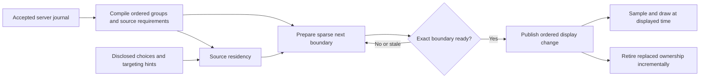

# Preparation, publication and ownership

Status: planning only; implementation has not started. Requested 15 October 2026.
This document supersedes the incremental performance continuation in
[the native spell migration plan](NATIVE_SPELL_CLIENT_MIGRATION_PLAN_2026-10-15.md).
Its event semantics, accepted artwork and outstanding artistic deferrals remain.

## 1. Outcome and scope

An already received action must become visible promptly, then play through its
ordered movement, reactions, impact and aftermath without synchronous preparation
interrupting rendering. Gameplay and Studio use the same presentation semantics.
Work done while targeting or playing earlier events prepares resources; it never
predicts outcomes or publishes future state.

The change is concentrated on existing preparation, publication and ownership
boundaries. It is not a renderer rewrite, a new ECS, a new VFX authoring language,
a new lighting system, or a backend optimization. Current factory work informs
the design and acceptance cases; bulk spell import is a separate implementation
task. No factory/backend artwork or implementation is edited by this plan.

Preserve Forward+/Vulkan, current source sampling and pixel density, authored
clocks, tint/material treatment, 2D normal lighting/cap, shadows, wall modes,
depth/sort conventions, audio policy and hierarchical event ordering. Correct
the reproduced floor-depth and Studio-setting defects against explicit oracles;
those known wrong outputs are not visual goldens. Aid, Bless, False Life and
Sacred Flame remain artistically unaccepted; other new factory candidates are
not approved merely because they load or render.

## 2. Evidence and the actual design problem

The frozen review found three reproduced defects:

- Prepared timeline advancement consumes one ready group per call and loses
  elapsed-time remainder, even without a world boundary. For `[0,0,100]` ms
  groups, `advance(16)` reaches 0 ms instead of 16 ms.
- A two-cell terrain batch produces only its representative tile's native VFX
  depth. Separate equivalent tiles produce both receivers.
- A Studio hit-material setting changed after loop preparation reverts when the
  candidate world replaces the displayed world.

The larger problem is repeated derivation and ambiguous ownership: requirements,
world membership and shader state are reconstructed by several owners. A
successful preparation can still fall back to full live reconciliation. More
cache certificates around these reconstructed structures cannot guarantee cheap
publication.

Review evidence: `.runtime/review-20261015/review-findings.json` and
`validation-summary.json`. All 154 production scripts parsed. Of 61 selected
validation entries, 42 passed cleanly, three reproduced production defects,
nine had stale fixtures, six lacked valid inputs/prerequisites, and one had an
exit warning. This is not full-client certification. Current-schema parity,
settings/targeting/history coverage and Python collection need qualification.

The last live evidence before the review still missed the objective: roughly
73–85 ms complete-packet-to-animation and 33–43 ms worst action frames. Those
runs do not isolate each later saved change and had other GPU applications
present. They are historical evidence, not a fresh baseline or promised saving.

## 3. First principles

1. **Facts, preparation and display have different owners.** The SDK retains
   the accepted server prefix. Preparation may inspect a later accepted prefix.
   The timeline alone advances the displayed prefix and presentation clock.
2. **Resource readiness is not resource publication.** Having bytes loaded does
   not mean private instances, receiver bindings, native programs and the exact
   first visible sample are ready.
3. **One owner produces a value.** Consumers receive references or explicit
   changes. They do not reconstruct equivalent maps and prove equivalence on
   every frame.
4. **Small changes remain small.** An actor step or one removed wall section must
   not enumerate every scene row or every catalog source. Genuine global changes
   such as a camera quarter or atlas repack remain explicit larger jobs.
5. **Preparation can yield; publication cannot discover work.** Missing/stale
   work returns to preparation while the old displayed frame remains coherent.
6. **Sharing follows mutability.** Immutable source images, shaders and verified
   prototypes may be shared. Mutable materials, particles, viewport outputs,
   occurrence clocks, sound voices and pane state remain independently owned.
7. **Lifetime is a received fact.** A demonstration's four-second window, an
   off-screen object or a completed casting action does not end a persistent
   spell, condition, section or item.

## 4. Proposed ownership boundaries

These are responsibilities within existing modules, not a demand for seven new
classes, managers or registries. Dependency direction stays acyclic.

| Existing boundary | Owns | Must not own |
| --- | --- | --- |
| `sdk/` and `presentation/session.gd` | Accepted ordered journal, server state, background preparation input, passive retirement | Display time, rendered VFX lifetime, client outcomes |
| `compiler.gd`, authoring resolvers | Ordered groups/commits and immutable requirements derived from exact authored selections | Nodes, GPU resources, current view mutation |
| `media_warmup.gd`, source admission | One source-residency account for the host session, required roles and per-consumer pins, source revision | Per-spell mutable playback state, hidden gameplay facts |
| `world_preparation.gd` and existing component preparation | Private sparse changes and exact objects/bindings needed at the next display boundary | Changes to the displayed scene, trace activation or audible playback |
| `timeline.gd` plus one publication coordinator in `play.gd` | Ordered display advancement and acceptance of the fully prepared next boundary | Synchronous source discovery, recovery rebuilding or blocking load |
| Actor/native/atlas/audio presenters | Sampling the published occurrence at displayed time; owned mutable outputs | Reinterpreting server rules or deriving truth from another material's uniforms |
| Studio | Replay selection, view preferences and private pane state; pins into the common source owner | Independent conflicting accounting for identical shared residency |

Keep canonical, prepared and displayed state separate. Eliminate redundant
directories only where they represent the same ownership, not because two states
look similar at a particular instant.

## 5. The preparation/publication flow

### 5.1 Resolve once, prepare ahead

At authored-source admission, resolve the resource dependency closure and native
variant identity once per source revision. At operation compilation, retain the
ordered occurrence requirements, source references and known cue boundaries.
Separate view-independent source needs from view-dependent receiver geometry.
Reuse the existing due-component filtering in `component_renderer.gd`; do not
introduce a second scheduler. Resolving immutable requirements once does not
freeze dynamic hand sockets, moving endpoints, view-dependent transforms or age.
Those continue to sample current published pose/time through the existing owners.
Use existing source metadata and compact socket samples; never read large masks
on the CPU just to rediscover a small attachment record.

Prioritize: next required display boundary; already received upcoming cues;
disclosed current action/targeting source hints; optional encounter reuse. The
priority affects work scheduling only. Starting a target preview cannot pay an
action, instantiate a visible spell, reveal a recipient, or start an audio cue.
Cancel obsolete optional interest without releasing another consumer's pins.

Compile requirements for the whole received operation, but do not wait for every
late cue before showing its beginning. Each cue must be prepared before its own
authored boundary; qualification measures later impact stalls as well as onset.

### 5.2 Extend the existing prepared result

The existing `WorldPreparation`/component results should carry the minimum data
needed to publish their exact boundary:

| Data | Purpose |
| --- | --- |
| Existing encounter/initialization identity, ordered group/commit cut and base displayed revision | Identify the accepted prefix this result extends |
| Relevant view, render-option and source revisions | Reject genuinely stale bindings; avoid invalidating on unrelated source changes |
| Changed/new/removed rows and explicit order changes | Preserve sparse work and original order |
| Prepared private nodes/buffers/material operands/atlas addresses and receiver changes | Apply the actual rendered change without reconstruction |
| Owned source pins, occurrence owners and pending retirements | Transfer or release exact ownership once |
| Completion/error state for worker, native construction and required draw preparation | Distinguish loaded, built, warm and publishable |

Do not introduce per-frame content hashes, generic transaction graphs, duplicate
membership directories or another hierarchy of receipts. Reuse existing revision
and occurrence identities, and replace the corresponding old proof when a single
producer now owns the value. New fields need a named caller and acceptance case.

Include discrete updates to persistent footprints, exclusions, suppression and
material family in this preparation boundary. `native_area_mask.gd` currently
creates/uploads a changed mask from `native_spell_renderer.gd` sampling; move that
resource work into preparation and bind the prepared result at the due cut.
Ordinary continuous per-frame motion/uniform sampling stays in the presenter.
Report unsupported input as an explicit error, not an endless preparing state.

### 5.3 Publication

Before changing anything displayed, validate the candidate against its base and
relevant dependencies. If invalid, retain the displayed world and reprepare only
the affected work. Atlas capture errors are errors or pending work, never a
successful ready result. Normal publication must have no full `_reconcile`,
blocking resource load, constructor, metadata scan or synchronous worker wait.

Publication applies prepared membership/order/material references and the exact
timeline cut together before sampling the visible frame. It then emits the
corresponding trace/log/audio crossings using the existing order. No intermediate
frame may show new state with old receivers, old visibility or half an outfit.
Audio from a hidden candidate remains muted and unstarted.

This is an explicit before/after boundary, not a general rollback engine. Do all
fallible discovery/construction before the first displayed mutation. Rejecting
preflight retains the old coherent scene. Once mutation starts there is no normal
candidate-rejection path. An unexpected commit fault halts further advancement
and exposes the existing copyable error and an explicit prepared recovery path;
it does not promise automatic restoration of the old scene. Never repair it by
executing a large fallback inside rendering.

An initial build, full recovery, view rebuild or atlas capacity growth can require
O(scene size) work. Perform that work as resumable preparation. For large atomic
changes, build private batches/bindings first and publish prepared references.
Changing thousands of visible nodes individually is not a constant-time swap:
measure the unavoidable commit and adjust representation if it cannot fit.
Do not publish a partial authoritative world to conceal a large commit.

For sparse projection, keep the published row/index base read-only while its
single preparation task borrows it. Build changed rows and removals in private
candidate data instead of cloning every retained index. Only the owning path
adopts those changes after the task is complete; a cancelled task's data never
mutates the base. The borrowed nested data is immutable and excludes mutable
render/sample state. Cancellation marks work obsolete; it does not end the borrow
or permit mutation/release of its base before the worker finishes reading.
Do not let concurrent jobs write the same cache. With N retained
rows and K changed rows, ordinary projection/publication should scale with K and
the resources/order relationships actually affected, not N. Large sight changes,
sorting changes and repacks have explicit affected sets and may legitimately
approach N; measure them separately. The first sparse proof must demonstrate this
ownership handoff before deleting the old copies, without adding a persistent
collection framework or moving an O(N) copy to a different method.

### 5.4 Native engine boundary and budgets

Use workers for immutable data processing and supported resource loading; keep
active-tree and mutable rendering operations on their proper owning thread. Check
threaded-load completion before retrieving it. `call_deferred` alone merely moves
work to a later frame. Keep the existing native compiler/mutation exclusion until
a native test establishes it can safely change.

Use one main-thread preparation allowance shared across world, atlas, native
spell, audio and optional work. Start with a measured 2 ms/frame preparation
allowance and a 1 ms publication target, within the existing 10 ms total-frame
objective. These are proposed engineering allocations, not achieved guarantees.
Charge full elapsed work, including retirement and diagnostics. Checking a timer
before a 5 ms constructor does not make that constructor a 2 ms job: split it,
prepare immutable geometry offline, or prepare the instance earlier. Record any
remaining indivisible work explicitly.

Godot documents thread limits and load blocking, and Forward+ pipeline warming
requires actual mesh/material/render-feature evidence. The 2D Canvas path needs
its own first-draw qualification; a loaded Shader resource is insufficient.
Use the existing bounded warmup path, not a new viewport per spell. References:
[thread-safe APIs](https://docs.godotengine.org/en/stable/tutorials/performance/thread_safe_apis.html),
[background loading](https://docs.godotengine.org/en/stable/tutorials/io/background_loading.html),
[pipeline compilation](https://docs.godotengine.org/en/stable/tutorials/performance/pipeline_compilations.html).
Verify these mechanisms on the installed 4.7.2 binary; documentation is guidance,
not proof of the local driver’s frame times.

## 6. Ordered time and publication

For an advance beginning at displayed time `t`, set the proposed target once:
`T = t + max(delta, 0)`. Complete ready groups in their existing compiler order
until reaching T, a genuine world publication boundary, or unmet required work.
After completing a group, update its ownership and then check the next group;
do not preflight it using the preceding group's pins. Zero-duration groups consume
no artificial animation time. Equal-time parent/child commits retain their source
ordinal; sorting by UUID or event type is forbidden.

A readiness wait does not accumulate wall-clock time or fast-forward animation on
resume. Within one call, retain the unused target remainder across ready groups.
At a genuine draw/publication boundary, preserve the current intentional yield
policy first; do not carry arbitrary real-time debt into later frames. Both live
and replay retain the same event/commit/audio ordering, but scheduling an explicit
seek target is different from advancing one live frame. If a very large zero-time prefix requires a
processing allowance, yield explicitly without committing out of order and
without inventing one frame per group; report that wait.

The SDK consumed cursor and transport ACK keep their existing contract: ACK follows
successful passive consumption/journal admission, independently of presentation.
Only the displayed operation cursor advances at its ordered operation-end cut.
Accepted/ACKed operations can wait for presentation while gameplay input remains
gated on the required displayed state. Staged first-disclosed supports cannot
overwrite canonical tiles already known at that cut.

An explicit replay/seek target is retained through preparation waits. Prepare its
entire prefix, including multiple world boundaries and zero-time tails, then publish
only the requested cut. Do not expose intermediate live-style draws or candidate
trace/audio while seeking. Restore persistent owners before sampling that cut.
Preserve the existing audio policies for crossed onsets,
expired clips, seek-inside and loop re-entry; do not make every crossed historical
sound play just because multiple groups now finish in one call.

## 7. Resource, instance and retirement ownership

Maintain one source record per explicit source path/variant and admitted revision.
Keep CPU image, GPU texture, fixture/normal/support roles distinct. Consumer pins
refer to that record; additions/removals update role counts incrementally.
Optional-to-required promotion takes priority immediately. Required resources
cannot be silently dropped to satisfy the optional cache budget. Preserve and
report the existing pinned-over-budget condition; do not claim a hard VRAM cap
from conservative texture estimates. Stop optional admission under pressure.

Shared resources must be audited immutable values. `Texture2D` alone does not
prove immutability: a viewport texture is a live output. Each occurrence retains
its own mutable shader operands, particle state, source clock, sound voices and
attachment/geometry state. Two recipients or Studio panes using the same source
must not change each other's colours, geometry or time.

On publish, transfer candidate pins to displayed owners before releasing replaced
owners. Cancellation releases only its candidate's interest. Workers own passive
snapshots; late completion from a cancelled epoch cannot install nodes, alter the
current trace or release another owner. Large passive destruction remains on the
existing retirement lane; scene/GPU destruction uses the appropriate thread and
budget. Closing does not block the render thread waiting for large obsolete work.

Studio's candidate, displayed world and spare share source residency accounting,
but retain independent reducers, nodes, materials and clocks. Freezing a spare
does not leave an unaccounted second cache. Session-level render preferences are
applied to candidates before their final draw/readiness, including hit-material
choice; a changed preference invalidates only the relevant prepared output.

Material operands have one producer. Actor/condition sampling produces compact
values and explicit changes; source, receiving and output materials consume them.
Avoid reading a ShaderMaterial back as another material's data authority. Keep
the existing tested delta implementation until this replacement is qualified;
remove redundant proof machinery when its owner is replaced, not in advance.
The latest saved actor/atlas parameter certificate passed the review's 374 native
checks, including ten added parameter-change cases against full-copy pixels.
That qualifies those cases only; full gameplay performance and shader-family
replacement are not qualified by that result.

## 8. Factory work that changes the design

Inspected the current working tree, not only committed/exported assets, at
`C:/Users/tommaso/Documents/assets/VFXFactory`. Its README points to current
15 October work; older inventory counts are historical. Current native work
includes the original library, 36 newer spell roots and a separate 22-root batch
(19 compositions plus three common summon-event previews). The client currently
registers 30 spells. Factory sampling evidence is neither visual approval nor
production event integration. The related backend spell worktree remains separate
from the running main server; its DefinitionRefs/schema must be checked when
integration is actually authorized.

The Factory uses a generated transitional copy under `integrations/ndclient`.
Its host now supplies inputs beyond the client's old sample/placement path.
Importing a manifest alone cannot supply those inputs. During this refactor,
record the host seams and keep their data roles compatible; refresh the generated
copy explicitly after upstream changes, never on startup or by hand-editing it.

The saved Resource exporter already includes `working_choreography`,
`factory_resource` and `review_status`; the client still reads separate legacy
staging. Plan the explicit package/binding handoff without inventing a new clip
protocol. Do not run the legacy intake tools as a shortcut:
`tools/prepare_native_effects.py` currently writes an index containing only
`sources`, which would drop its existing spell registrations when used alone.
Protect existing registrations and source dependencies before any later intake.

Current Factory components expose live endpoint, owner-state and transition-event
inputs (`set_live_endpoints`, `set_owner_state`, `set_transition_events`). Its
preview host also supplies endpoint/geometry sampling, dynamic registration,
pose capture and material-family admission. Component fixture coverage is not a
complete generic host/event bridge. The client does not yet implement these
complete seams. Adapt
declared capabilities explicitly at source admission; never infer support from a
spell name or blindly invoke arbitrary methods. Factory `review_states`, example
trajectories and `fixture_inputs` remain test data. Discrete topology, resource,
membership and material-family changes must be prepared before visibility;
one initial geometry scan cannot cover every future registration. Continuous
source-defined geometry and material-clock updates remain displayed-time sampling
and are measured separately. For example, Blade Barrier rebuilds ribbon mesh data
during sampling; admitting its source does not prove that those frames are cheap.
Do not turn every such sample into a new world candidate. New occurrence nodes,
source families and structural receiver registrations still require preparation
before visibility. A source requiring unsupported structural updates remains an
explicit integration gap, and costly continuous sampling needs its own measured
source-preserving correction before that source passes performance acceptance.

| Existing factory case | Required ownership/publication behavior | Integration limit to retain |
| --- | --- | --- |
| Wall spells, Blade Barrier, Forcecage | Stable disclosed owner/section IDs, endpoint/coverage geometry, elevation and independent section changes. One removed section leaves the remaining geometry and clock intact. Prepare colour and native depth/receiver changes together. | No client collision, crossing damage, escape rules or inferred hidden sections. A wall source does not imply that its physics is authoritative. |
| Ice wall breach / variable-size barrier | Removed solid geometry and a surviving cold-air field have distinct owners. Blade Barrier geometry is built from admitted length/height; its birth length is invariant, so a changed shape needs a prepared replacement. | Never stretch a constructor past its contract or retire the whole parent when one subowner ends. |
| Forcecage breach versus full box removal | Exact section subset versus complete owner retirement, matching supplied outcome. | No generic spell-name rule deciding which form is destructible. |
| Moving Aura of Life / Antilife Shell | Source owner, anchor transform and recipient membership have separate changes; retain persistent resources across movement and contact events. | No local overlap/HP inference to create healing, reveal or expiry. |
| Holy Aura / Foresight / overlapping conditions | Cast/source identity survives independently of individual recipient leases; remove the exact lease. Retarget releases the old owner at the actual new release. | Do not collapse all conditions by display name or treat decorative emission as authoritative optical light. |
| Delayed Blast Fireball / portable Freezing Sphere | Item identity survives holder/container/floor transfers, original caster differs from current holder, persistent clock survives clip end. Accepted retirement precedes one accepted blast. | No timer-inferred detonation; cancellation/veto/suppressed or administrative ending can produce no blast. |
| Arcane Sword and summons | Effect/entity owns movement and attack independently of caster animation. Prepare disclosed body/action assets before appearance. | Three summon previews do not supply the twelve missing body bindings or action animations. No humanoid substitutions. |
| Flesh to Stone | Capture the actual admitted pose on Petrified admission; retain facing/frame and owner. Material-family change/restoration is prepared, not just a scalar uniform update. | Public progression count is absent in the handoff; do not count failures locally. Existing tentative stand/dance clips remain gaps. |
| Water/blood/oil/Web transitions | Stable field plus ordered accepted cell subsets, retained shape and explicit patch-local coordinate conversion; secondary SteamCloud has its own owner. | Current surface patch is four cells wide and permits at most 32 operation/cell records. Partition explicitly; no silent truncation or invented thaw/uncharge rules. |
| Multiple missiles, beams, impacts and audio | Separate occurrence/recipient identities using shared immutable sources; all tracks retain actual onset and contact clocks. | No one-global-handle-per-spell shortcut and no restarting agreeing motion. |

All field geometry must come from disclosed state/preview inputs appropriate to
that stage. Preserve current grid/elevation units through one adapter; do not
spread hard-coded two-coordinate assumptions through resource ownership. The
backend XYZ proposal is separate, unimplemented work; this plan does not migrate
the protocol or invent missing height data.

Native floor support must consume every actual batch member and visibility/elevation
change. Depth support for scenery, transparent bodies, refraction, normal/ORM
decals and particle collision is still only partially qualified. A new effect
requiring one of those capabilities must report the missing integration rather
than claim full compatibility or quietly remove an art layer. Preserve current
source clocks and material choices while the capability is implemented separately.

Factory references:
- [Native authoring](/mnt/c/Users/tommaso/Documents/assets/VFXFactory/docs/NATIVE_AUTHORING.md)
- [High-level spell handoff](/mnt/c/Users/tommaso/Documents/assets/VFXFactory/docs/HIGH_LEVEL_22_NATIVE_REVIEW_HANDOFF_2026-10-15.md)
- [Surface transitions](/mnt/c/Users/tommaso/Documents/assets/VFXFactory/docs/NATIVE_SURFACE_TRANSITIONS_2026-10-15.md)
- `factory/core/committed_surface_events.gd`, `factory/authoring/export_manifest.gd`
- Backend reference: `/home/tommaso/.codex/worktrees/spells-rank-one-two/dnd_engine/agent_docs/GODOT_HIGH_LEVEL_22_SPELL_HANDOFF_2026-10-15.md`

## 9. Implementation sequence and removal obligations

Each step ends with an independently reviewed, runnable client. Do not implement
several replacement ownership systems at once or add a permanent old/new runtime
switch. Keep a deterministic old-path oracle only in tests while needed.

| Step | Change and primary files | Exit evidence / old work removed |
| --- | --- | --- |
| 0. Reliable baseline | Existing SDK/native/live harnesses, affected stale fixtures, `frame_profile.gd` | Repair only fixtures needed for this acceptance matrix, not all 375 scripts. Current-schema corpus and real scene setup; errors fail regardless of exit status. Separate cheap default counters from explicit detailed profiles; measure their overhead. Save current source/art baseline and one comparable live route without reverting user work. |
| 1. Ordered advancement | `timeline.gd`, existing component/audio crossing integration | Ready-group remainder and equal-time cases pass. Keep real publication waits and audio policy. Remove unconditional one-group-per-frame delay. |
| 2. Compiled requirements and shared residency | Compiler/resolvers, `media_warmup.gd`, `component_renderer.gd`, `replay_panes.gd` | First retain compiler-owned requirements and remove repeated closure reconstruction; then consolidate media-owned residency and remove duplicate directories/demand proofs. Incremental consumer roles/pins, cancellation and shared-pane accounting pass at each substep. |
| 3. Sparse world candidate | `world.gd`, `world_preparation.gd`, ground batching/order | Changed/removed rows and explicit ordering propagate through preparation. One-tile work independent of unrelated scene size; genuine global jobs explicit. Remove full wanted/membership reconstruction for sparse updates. |
| 4. Exact publication | `play.gd`, `native_light_delta.gd`, `native_light_atlas.gd`, native/component/audio preparation | Build actual bindings/private resources before ready. One shared preparation budget; stale candidates return to preparation. Full rebuild removed from ordinary publication, retained only as prepared initial/recovery work. Validate floor-batch correction here. |
| 5. Material and Studio ownership | Actor operands, atlas bindings, Studio preference/candidate/spare lifecycle | Producer operands bind all destinations; no material readback authority. Latest options survive loop/seek. Remove replaced proof/mirror logic; release spare interest. Same-source peers remain independent. |
| 6. Combined acceptance | Existing actual-input player and Studio harnesses | Warm/cold/target-prefetched spell onsets, impact, movement reveal, cancellation, pressure and loops pass together. Record every slow frame, not just average FPS. |

Steps 2–4 are the core design correction. Review their boundaries before code.
The broader `Play extends main.gd` inheritance cleanup is deferred unless a
specific shared helper prevents these changes; a wholesale controller extraction
would enlarge this task without proving the latency objective.

## 10. Acceptance cases

Tests enter through serialized recorded input, timeline advance, public scene
loading or actual UI actions. Existing private-state reproductions remain bug
evidence; convert the maintained regressions to supported fixtures. Do not bless
stale fixtures by changing expected values until they pass.

Specifically, `timeline_readiness_checks.gd` currently asserts one readiness call
per advance and old-scheduler parity. Retain its state/ownership rejection cases,
but replace those implementation-shaped assertions with an independent ordered
prefix and elapsed-time oracle. Old-path parity is useful for unchanged graphics,
not for preserving the reproduced scheduler defect.

| Case | Observable requirement |
| --- | --- |
| Ready zero/short groups, hierarchical equal-time effects | Same ordered state/log/trace prefix as immediate execution; `advance(10)` over `[0,2,3]` reaches 10 ms, commits once. |
| Next group missing a required source | No premature activation/commit/audio; old scene renders; no elapsed wait catch-up. Required promotion resumes in order. |
| Accepted operation ACKed while presentation is waiting | Transport acknowledgement proceeds under its journal contract; displayed cursor and input readiness do not advance prematurely. |
| Seek target crossing two world boundaries and a zero-time tail, later source missing | Retain requested target and old frame through waits; publish the complete requested cut once ready, with no intermediate candidate audio/trace. |
| Equal-time world commits and first-disclosed support | Exact state, visibility and receivers appear together; staged data never overwrites canonical data. |
| Cast → reaction → multi-hit damage → death | Nested order, participant tracks and occurrence identity preserved in gameplay and Studio. |
| Crossed audio onset, expired cue, seek and loop | Existing start/skip/seek policy; no silent missing valid onset, double voice or candidate sound. |
| Condition plus field sharing a source | Independent owners/clocks; suppression, restore and removal use actual events, including after cast track ends. |
| Cancel A for B after worker completion | Late A cannot publish or release B/live resources; no resurrected voice/effect. |
| Same-path authoring reload with an old live occurrence | Existing occurrence remains valid; new occurrence uses new source and independent mutable values. |
| Optional GPU-only source promoted to CPU+GPU/fixture, two consumers | Accurate roles, no premature eviction; optional pressure never gates required publication. |
| Actual terrain MultiMesh, two cells plus raised/hidden/removed member | Native depth equals the equivalent unbatched oracle across four quarters; no missing second receiver. |
| Studio hidden candidate plus changed option/view | Latest hit-material/quarter/grid/wall preference and pause intent survive publication. |
| Repeated distant seeks/loops/source changes | Residency stabilizes at the accounted working set; destroyed/frozen owners do not retain unexplained resources. |
| Factory section/field/item lifecycle samples | Source inputs survive geometry updates, partial retirement, transfer and cancellation. Label fixtures as component inputs until a real server recording exists. |

Use current real recordings for movement/reveal, Fireball, Magic Missile,
Scorching Ray, Shield reaction, hide/reveal and death. For new factory capabilities,
use the available bounded source fixtures to test the proposed seam; only a
matching real server recording can qualify gameplay integration. Missing media
or unmerged protocol support stays an explicit gap.

Graphics checks combine independent simple controls (batched versus unbatched
depth), exact uniform/framebuffer parity where deterministic, and bounded
multi-frame contact sheets for stochastic/native effects. Include impact,
recovery, late persistent state, four camera quarters and supported zooms.
No single screenshot, headless run or self-comparison certifies appearance.

## 11. Performance evidence and completion

Use actual client-issued movement and spells into the large room, both gameplay
and Studio single-view replay. Keep assets, renderer, quality and authored clocks
fixed. Record the running server/schema, warm/cold source state and competing GPU
work; do not stop the user's applications. Keep server execution and transport
separate from client complete-packet-to-first-animation and later cue readiness.

Retain the user's targets: under 30 ms client packet-to-first-animation in the
prepared/warm action case and 100+ FPS with no client-induced spikes throughout
the action. Report p50/p95/p99/max and **every frame over 10 ms**, including impact,
reveal, logging, retirement and UI work after previous timers. A cold uncached
source is a separate measured lane, never silently combined with warm results.
Waiting on a required source must not block drawing; it also is not a latency win.

Break slow samples into receive/decode, compile, worker queue/compute, source
load/publication, native construction/warmup, world/atlas preparation, commit,
sampling/UI, retirement and draw interval. Preserve inclusive/exclusive timing
labels and avoid summing overlapping phases. The total frame interval is the
acceptance measure. Compare profiling enabled/disabled on the same recording.

Structural completion requires: reproduced bugs fixed; required ownership invariants
qualified; no ordinary full-rebuild publication fallback; no concealed candidate
audio/visibility; approved graphics preserved; repaired relevant test coverage;
combined real-input evidence at onset and impact. Performance acceptance is a
separate gate: any missed under-30-ms or no-client-spike criterion remains open,
even after structural completion. Reporting a remaining failure does not satisfy
that objective. Passing isolated microbenchmarks is insufficient.

## 12. Reviewers and stop conditions

- **Antislop / anti-OOP reviewer:** challenge duplicate ownership, speculative
  services/registries, cache certificates replacing clear ownership, permanent
  fallback paths and out-of-scope controller rewrites. Require deletion of old
  work when a replacement lands.
- **Correctness / plan-adherence reviewer:** track ordered prefixes, audio policy,
  disclosure, private resources, cancellation, graphical parity and the overall
  objective; interrupt detours into negligible local optimizations.
- **Factory integration reviewer:** check actual current source APIs and lifecycle
  requirements, distinguish preview data from server facts and artistic approval.
- **Root:** owns the plan, cross-boundary decisions, combined qualification and
  user-facing evidence. Reviews happen at the design boundary, each ownership
  replacement, and final integrated result.

Stop expanding an implementation step when its work no longer serves these
acceptance cases. A new protocol fact or artistic decision is recorded as a
specific dependency rather than guessed. If a proposed optimization only moves
the stall, changes art, or requires parallel full-state mirrors, revise the design
before adding another patch.

## 13. Plan review outcome

All three reviewers read the actual draft. Their required corrections are now
incorporated: preflight-only old-scene retention, measured continuous geometry
sampling, independent structural/performance gates, precise Factory component
versus host claims, protocol ACK versus displayed progress, and explicit seek
targets versus live per-frame yielding. The sparse-base borrow remains protected
until a cancelled worker actually finishes. No new design blocker remains from
the source review.

This qualifies the plan's stated design and scope only. No runtime implementation
or performance acceptance has been completed by writing it. The reviewer roles in
§12 remain part of implementation and final qualification.
